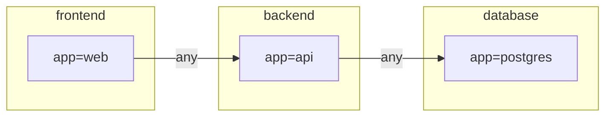

# kubectl-netpol: Architecture & Design

## Problem Statement

Kubernetes network policies (NetworkPolicy, AdminNetworkPolicy, BaselineAdminNetworkPolicy)
are powerful but notoriously hard to reason about:

- Policies are written as YAML rules with label selectors and port lists
- Three policy layers (ANP → NetworkPolicy → BANP) interact with each other
- There is no built-in way to ask "can pod A talk to pod B?"
- Debugging requires reading multiple YAML files mentally and simulating rule evaluation
- Existing tools (np-guard/netpol-analyzer) output raw IP/port lists that are hard to read

The goal of this project is to make network policy intent **visible** and **verifiable**.

---

## Design Goals

1. **Human-readable output** — zone-based matrix, not IP/port lists
2. **Test what you see** — generate and run actual connectivity probes
3. **Zero config** — derive everything from existing K8s resources
4. **Broad compatibility** — works on any Kubernetes cluster; ANP/BANP as progressive enhancement
5. **Composable** — plays well with Ansible, CI/CD, and GitOps workflows

---

## Key Insight: Labels as Zones

Traditional network security thinks in **security zones** (DMZ, Internal, DB-Tier), not individual IPs.
Kubernetes NetworkPolicy already uses **label selectors and Namespaces** — these ARE the zones.

| Traditional Networking | Kubernetes Equivalent |
|---|---|
| Security Zone | Namespace |
| Host group / service group | Pod label (`app=frontend`) |
| Firewall rule | NetworkPolicy / ANP / BANP rule |
| Rule priority | ANP priority (0–99) > NetworkPolicy > BANP |

Visualizing policies at the **label/namespace level** — not at the IP level — is the right abstraction.

---

## Two-Tool Architecture

```
┌─────────────────────────────────────────────────────────┐
│  kubectl netpol analyze                                 │
│  (Static analyzer & visualizer)                         │
│                                                         │
│  Input:  K8s resources (ANP, NetworkPolicy, BANP,       │
│          Pods, Namespaces)                              │
│  Output: Zone matrix, Mermaid diagram, HTML report,     │
│          JSON connectivity map                          │
└───────────────────────┬─────────────────────────────────┘
                        │  connectivity map (JSON)
                        │  (optional — probe can also run standalone)
                        ▼
┌─────────────────────────────────────────────────────────┐
│  kubectl netpol probe                                   │
│  (Live connectivity tester)                             │
│                                                         │
│  Input:  connectivity map OR inline flags               │
│  Output: pass/fail per test case, JUnit XML / JSON      │
│  Mode A: In-cluster Job (pod-to-pod, egress tests)      │
│  Mode B: External runner via Ansible (ingress tests)    │
└─────────────────────────────────────────────────────────┘
```

### Why two separate tools?

| Concern | `analyze` | `probe` |
|---|---|---|
| Requires live cluster? | No (can work offline with exported YAML) | Yes |
| Network access needed? | No | Yes (spawns test pods) |
| Speed | Instant | Seconds to minutes |
| Use in GitOps / PR review | Yes | No |
| Use in post-deploy verification | Limited | Yes |

---

## Policy Layer Evaluation

ANP, NetworkPolicy, and BANP are evaluated in strict order. The analyzer must model this:

```
Packet arrives at destination pod
  │
  ▼
[1] AdminNetworkPolicy (priority 0–99, lowest number wins)
    ├── Action: Allow → ALLOW (stop)
    ├── Action: Deny  → DENY  (stop)
    └── Action: Pass  → continue to next layer
  │
  ▼
[2] NetworkPolicy (if pod is selected by at least one policy)
    ├── Matched by ingress rule → ALLOW
    ├── No matching rule, but pod IS selected → DENY (default deny)
    └── Pod NOT selected by any policy → continue to next layer
  │
  ▼
[3] BaselineAdminNetworkPolicy (cluster-wide fallback)
    ├── Action: Allow → ALLOW
    └── Action: Deny  → DENY

Default (no policies at all): ALLOW
```

### Port / protocol awareness

Each src→dst pair is evaluated **per port query**, not once for “all traffic”:

| Query | Meaning |
|---|---|
| `8080/TCP` (etc.) | Explicit ports collected from matching ANP / NP / BANP rules (ranges → endpoints) |
| `0/*` (`any`) | Catch-all for traffic not covered by an explicit port list |

- Empty `ports:` on a rule = all ports (matches every query, including `any`)
- Explicit port lists do **not** match `any` — so NP/ANP allow-lists correctly deny unspecified ports
- Named ports are skipped for numeric queries (※未対応)
- Pair `Overall` = Allow if **any** port Allows; Deny if all Deny

Table / Mermaid / HTML / JSON surface concrete Allow ports (e.g. `8443/TCP [NP]`).

Reference: [Kubernetes Network Policy API](https://network-policy-api.sigs.k8s.io/)

---

## Test Case Derivation (Boundary Value Approach)

Rather than requiring a hand-written test spec, `analyze` derives test cases automatically
from the policy rules themselves — analogous to **boundary value testing**.

For each policy rule, generate:

```
Rule: allow ingress from namespace=frontend, port 8080/TCP

→ Positive test (MUST PASS):
    from: pod in namespace=frontend → port 8080/TCP → ALLOW

→ Boundary tests (MUST FAIL):
    Port boundary:     frontend → port 8079/TCP → DENY
                       frontend → port 8081/TCP → DENY
    Namespace boundary: pod NOT in namespace=frontend → port 8080/TCP → DENY
    Protocol boundary:  frontend → port 8080/UDP → DENY
```

### When is a hand-written spec useful?

Derived tests verify "does the CNI implement what the policies declare?"
A hand-written spec verifies "do the policies express what we actually intend?"

Example intent that cannot be derived from a single policy:

```yaml
# Business requirement: no pod should ever reach the internet
# This requires reasoning across ALL egress policies holistically
- from: any-pod
  to: 0.0.0.0/0
  port: any
  expected: deny
  reason: "Security requirement: no external egress"
```

An optional `--spec` flag allows supplementing derived tests with intent-level assertions.

---

## Policy-only mode (no Pods)

When `analyze` loads **zero Pods** but at least one NetworkPolicy / ANP / BANP, it **synthesizes zones from policy selectors** and runs the same 3-layer evaluation.

| Selector | Synthetic zone |
|---|---|
| `namespaces.matchLabels` / `matchExpressions` | Virtual Namespace + group `all-pods` |
| `kubernetes.io/metadata.name In [...]` | Named Namespace per value |
| `pods` (ns + podSelector) | Group with those pod labels |
| `networks:` / NP `ipBlock` | Display `cidr:<CIDR>` (internal key `_network/cidr=…`). IP peer, not a Namespace; not inherently “external”. |
| Empty `namespaces: {}` | No zone created (matches all ns zones at evaluation time) |

Stderr reports: `Synthesized N zones from policies (no pods loaded)`.

```bash
# Offline: policy YAML only (no pods.yaml / namespaces.yaml required)
go run . analyze --from-dir path/to/policies -o table
go run . analyze --from-dir path/to/policies -o html > /tmp/netpol.html
```

When Pods are present, behavior is unchanged (real workload grouping). Merging real Pods with synthesized zones is out of scope.

CIDR matching is **exact string equality** against synthesized `_network/cidr=...` zones (no CIDR containment). Nodes peers remain unsupported.

See `testdata/08-policy-only-anp-banp/` for a fixture with policies only.

---

## Visualization Output Formats

All implemented in pure Go (no external tools required).

### Role of each format

| Flag | Role | What it shows |
|---|---|---|
| `-o table` (default) | **Authoritative pass/fail matrix** | Source × Destination ✓/✗ with policy layer tag |
| `-o mermaid` | **Topology story — who can talk to whom** | Allow edges only. Grouped by namespace. Port-first labels. |
| `-o mermaid-full` | Debug / full picture | Allow + Deny. Warns when graph is too large to read. |
| `-o html` | **Interactive report** | Allow topology (no on-edge captions) + side panel for port/layer. Hover dims unrelated nodes/lines. |
| `-o json` | Machine-readable | Full matrix as JSON. Probe input. |

**Key principle:** `table` is the source of truth for Allow/Deny coverage. `mermaid` is a readable summary of reachable paths — Deny edges belong in `table` or `mermaid-full`. HTML does **not** put port labels on Mermaid edges (SVG label sync is brittle); details live in the side panel.

### `--focus` flag

The `--focus <selector>` flag narrows the diagram to a specific node set and its direct Allow neighbors. Applies to `-o mermaid`, `-o mermaid-full`, and `-o html`; ignored for `table` and `json`.

**Selector syntax:**

| Selector | Meaning |
|---|---|
| `ns=<namespace>` | All groups in the given namespace |
| `<key>=<value>` | Groups where `Labels[key] == value` (any label key, e.g. `app=api`, `tier=frontend`) |
| `<namespace>/<key>=<value>` | Exact group match (namespace + label expression) |

**Examples:**
```bash
--focus ns=monitoring
--focus app=api
--focus tier=frontend
--focus tenant-a-app/app=api
```

**Behavior:**
- Keeps all focus nodes plus any node with at least one Allow edge to or from a focus node.
- Prints to stderr: `focus: <selector> — N nodes, M edges shown`
- Exits with code 1 if the selector matches nothing.

### Mermaid edge label format

Edge labels are port-first, layer is a short suffix when non-default:

```
any           — wildcard (no specific port policy)
8080/TCP      — specific port, default allow
8080 [NP]    — specific port decided by NetworkPolicy
any [ANP]    — any port, decided by AdminNetworkPolicy
any [BANP]   — any port, decided by BaselineAdminNetworkPolicy
```

### Example: `-o table`

```
ZONE CONNECTIVITY MATRIX
Source \ Destination   backend/app=api              database/app=postgres
backend/app=api        -                            ✓ [NetworkPolicy] 5432/TCP
frontend/app=web       ✓ [NetworkPolicy] 8080/TCP   ✗ [NetworkPolicy]
```

### Example: `-o mermaid` (allow-only)



### Large-graph guidance

When Allow edges > 20: `mermaid` prepends a warning comment suggesting `-n <namespace>` or `-o table`.
When groups > 6 or total edges > 20: `mermaid-full` also warns on stderr.
Use `--focus` to narrow large diagrams without manually specifying a namespace filter.

### `-o html` interactive behavior

The HTML output is a single self-contained file (CDN for Mermaid.js).

**Why no on-edge labels in HTML:** Mermaid SVG edge captions do not reliably share DOM order or IDs with edge paths. Syncing “dim this line ⇒ dim its caption” was flaky (labels vanishing on keep edges, or staying on dimmed edges). HTML therefore:

1. Renders Allow arrows **without** `|label|` captions
2. Dims only **nodes + edge strokes** on hover/pin
3. Shows port/layer in a **side panel** fed by embedded JSON (same data as `-o mermaid` labels)

**Interactions:**

- **Hover node**: dim unrelated nodes/lines; remaining edges are colored **OUT (blue)** / **IN (green)** relative to the focus node
- **Hover panel row**: spotlight that edge (thicker; stroke keeps IN/OUT hue). Moving from graph → panel keeps focus
- **Click node**: pin; click again or SVG background to clear
- Panel lists Allow edges (`OUT` / `IN` + peer + port/layer). Adjacency/edges/names are embedded JSON
- Node IDs use the same `sanitizeID` as the Mermaid diagram

**Still best-effort:** stroke coloring uses path `id` / `<title>` parsing (`L-src-dst-N`). Node dimming and the side panel do not depend on that.

### Policy checks — `verify` (implemented)

Runtime evaluation is not “wrong” when ANP Deny wins over NP Allow — that is the model. `verify` is a **review aid** for lower-layer rules that never take effect.

```bash
go run . verify --from-dir path/to/policies
go run . verify --from-dir path/to/policies --warnings-only
go run . verify --from-dir path/to/policies --strict   # exit 1 if any Warning
```

| Severity | Code | Meaning |
|---|---|---|
| Warning | `shadowed-allow` | Higher Deny hides lower Allow (ANP≻NP/BANP, or NP≻BANP) |
| Info | `np-overrides-banp` | NP Allow wins over BANP Deny (model-correct allow-list) |
| Info | `anp-skips-banp-deny` | ANP Allow means BANP Deny is not consulted for that pair |

Exit `0` for Info-only (and for Warnings unless `--strict`). Not a YAML schema linter.

### Future: hub compression (not yet implemented)

Nodes like `monitoring` that fan out to all other namespaces create visual clutter.
A future `--compress-hubs` flag could collapse them: render `monitoring → * (all namespaces)` as a single annotated node rather than N individual edges.

---

## Probe Design

### Test Pod

Base image: `registry.access.redhat.com/ubi9/ubi-minimal`

```dockerfile
FROM registry.access.redhat.com/ubi9/ubi-minimal
RUN microdnf install -y nmap-ncat curl && microdnf clean all
COPY netpol-probe /usr/local/bin/
```

Rationale:
- UBI9 is freely redistributable (no subscription required)
- `ncat` covers TCP/UDP connectivity testing
- `curl` covers HTTP-level testing
- Same binary handles both probe execution and result reporting

### Test Pod Label Strategy

The test pod **must carry the same labels as the workload it impersonates**,
otherwise NetworkPolicy selectors will not match correctly.

```
Original pod:  app=frontend, version=v1  (in namespace: frontend)
Test pod:      app=frontend, version=v1  (in namespace: frontend)
               + netpol-probe=true       (for cleanup selection)
```

### DENY Detection

```
TCP ALLOW: connection established within timeout
TCP DENY:
  - CNI sends TCP RST → immediate failure (fast)
  - CNI drops packet  → timeout (slow; default 3s, configurable)
UDP DENY:  timeout-based only (connectionless protocol)
```

### Cleanup

All test pods are labeled `netpol-probe=true` for deterministic cleanup:

```bash
kubectl delete pods -l netpol-probe=true --all-namespaces
```

---

## Scope

### In Scope (Phase 1)

- NetworkPolicy (all Kubernetes clusters)
- AdminNetworkPolicy / BaselineAdminNetworkPolicy (network-policy-api.sigs.k8s.io)
- Pod-to-pod connectivity (same namespace, cross-namespace)
- Pod-to-Service (ClusterIP)
- Egress to external CIDR
- Protocol: TCP

### In Scope (Phase 2)

- Ingress from external (Route / LoadBalancer) — requires external runner
- UDP
- Ansible role for external probe execution
- Prometheus metrics export (policy drift detection)
- krew registration

### Out of Scope

| Area | Reason | Alternative |
|---|---|---|
| `openshift-*` internal traffic | Managed by OCP operators, not user policies | `oc adm diagnostics`, `oc get co` |
| L7 policies (HTTP path/method) | Service mesh layer | Istio / Kiali |
| mTLS / SPIFFE | Identity layer | OPA, cert-manager |
| FQDN-based policies | CNI-specific extension | Cilium tooling |
| Node-to-pod (HostNetwork) | Infrastructure layer | Phase 2 consideration |

---

## Implementation Plan

### Repository Structure

```
kubectl-netpol/
├── cmd/
│   ├── analyze.go          # kubectl netpol analyze
│   └── probe.go            # kubectl netpol probe
├── pkg/
│   ├── analyzer/
│   │   ├── networkpolicy.go
│   │   ├── anp.go          # AdminNetworkPolicy
│   │   ├── banp.go         # BaselineAdminNetworkPolicy
│   │   └── matrix.go       # 3-layer evaluation engine
│   ├── visualizer/
│   │   ├── table.go
│   │   ├── mermaid.go
│   │   └── html.go
│   └── probe/
│       ├── job.go          # Test Job lifecycle
│       └── result.go
├── images/probe/
│   └── Dockerfile
├── go.mod
└── main.go
```

### Dependencies

```
k8s.io/client-go                  — Kubernetes API client
sigs.k8s.io/network-policy-api    — ANP / BANP type definitions
github.com/spf13/cobra            — CLI framework (kubectl plugin standard)
```

No external visualization tools required. All output is generated by Go's standard library.

### Roadmap

```
v0.1  NetworkPolicy support
      — analyze: text matrix output
      — probe: TCP pod-to-pod test

v0.2  ANP / BANP support
      — 3-layer evaluation engine
      — Mermaid and HTML output

v0.3  Boundary value test derivation
      — auto-generate test cases from policies
      — optional --spec flag for intent tests

v0.4  Ansible integration
      — Job-based probe for external runners
      — JUnit XML output

v0.5  krew registration
      — Dockerfile + image push pipeline
      — krew manifest
```

---

## Differentiation from Existing Tools

| Tool | Analyze | Probe/Test | ANP/BANP | Zone View |
|---|---|---|---|---|
| np-guard/netpol-analyzer | ✓ | ✗ | ✗ | ✗ |
| Cilium Hubble | observed traffic | ✗ | ✓ | ✓ |
| Calico Enterprise | ✓ | ✗ | partial | ✓ |
| **kubectl-netpol** | **✓** | **✓** | **✓** | **✓** |

The combination of **static analysis + live probing + ANP/BANP support** is the differentiator.

<!-- PROMOTE: knowledge/openshift/networking/network-policy-analysis -->
